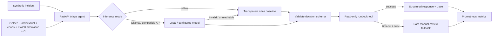

# Agentic Quality & Reliability Lab

**role-aligned independent demonstration. Reproducible QA engineering for AI agents:** agent/tool workflow validation, real local inference adapters, golden-set evaluation, failure injection, flaky-test diagnostics, risk-aware regression selection, HTTP load checks, Prometheus/Grafana observability, and GitHub Actions gates.

> **Portfolio engineering demonstration** using synthetic incidents and read-only mock runbooks. Not an accelerator product, a GPU benchmark, a production system, or evidence of professional ownership of NeMo/NIM/GPU infrastructure. The optional OpenAI-compatible NIM adapter is an integration path, not an assertion it was executed.


## Recommended Mac setup (Docker Desktop)

Docker Compose starts the real FastAPI app, **Prometheus** and **Grafana** locally. Prometheus/Grafana do not need separate installation. Python 3.10+ is required for host-side quality tests and evidence collection.

```bash
cd ~/Downloads/agentic-quality-reliability-lab
bash start-docker.sh
```

The script runs Python tests, builds the app image, generates QA reports and checks **live Prometheus scraping and Grafana provisioning**, refusing to claim success unless all HTTP checks pass. It prints the verified endpoints:

- QA dashboard: `http://127.0.0.1:8000/dashboard`
- API: `http://127.0.0.1:8000/docs`
- Prometheus: `http://127.0.0.1:9090/targets`
- Grafana: `http://127.0.0.1:3000`

Stop containers with `docker compose down`. See [Mac installation and troubleshooting](START_HERE_MAC.md).

### Python-only fallback (no Docker)

```bash
bash run-local.sh
```

The fallback runs the quality harness and built-in dashboard, but **does not** run Prometheus or Grafana. Optional inference, Kubernetes, failure-simulation, and accelerator checks remain separately gated; none is claimed verified merely because its configuration exists.

## Verification and evidence

Run `make verify-everything` to check local tests, integrations, GitHub Actions, and measured human QA work. Every external check returns verified, blocked, or failed. See [START_HERE_MAC.md](START_HERE_MAC.md) and [docs/COMPLETE_VERIFICATION.md](docs/COMPLETE_VERIFICATION.md).

## Why this is interesting

A small incident-triage agent classifies a synthetic issue, retrieves a **local read-only runbook** via a tool, and returns a typed action proposal. The QA harness measures classification, severity, tool use, output contracts, explicit model fallbacks, tail latency and failure recovery. Unlike a single happy-path chatbot demo, this repo includes negative cases, prompt-injection attempts, a separate fault harness, regression comparison and machine-readable quality evidence.



## Quick start: macOS Apple Silicon / Linux (no GPU, no API key)

Prerequisites: Python **3.10+** (Python 3.11 recommended), Git. Docker Desktop is optional.

```bash
unzip agentic-quality-reliability-lab.zip
cd agentic-quality-reliability-lab
python3 -m venv .venv
source .venv/bin/activate
python -m pip install --upgrade pip
python -m pip install -e '.[dev]'
python -m pytest -q
python -m agent_quality_lab eval
python -m agent_quality_lab chaos
python -m agent_quality_lab generate
python -m agent_quality_lab flaky
python -m agent_quality_lab select --budget 6
python -m agent_quality_lab advanced --repeats 3
python -m agent_quality_lab inference-chaos
python -m agent_quality_lab efficiency --budget 6
python -m agent_quality_lab gpu-diag
```

Expect a green offline test suite and `QUALITY GATE PASSED`. Results are saved under `artifacts/` (ignored by Git) as JSON/Markdown evidence. **Offline baseline** reports `model_used_rate: 0.0` by design. For the end-to-end environment setup, see [START_HERE_MAC.md](START_HERE_MAC.md) and [COMPLETE_VERIFICATION.md](docs/COMPLETE_VERIFICATION.md).

### Start the live agent API

Terminal 1:

```bash
source .venv/bin/activate
python -m agent_quality_lab serve
```

Terminal 2:

```bash
curl -s http://127.0.0.1:8000/api/health
curl -s -X POST http://127.0.0.1:8000/api/triage \
  -H 'Content-Type: application/json' \
  -d '{"incident_id":"DEMO-001","message":"Production down after Kubernetes deployment"}'
curl -s http://127.0.0.1:8000/metrics | grep aq_triage
```

Interactive OpenAPI docs: http://127.0.0.1:8000/docs . The API binds to loopback by default.

### Run a real local model with Ollama (optional)

Install [Ollama](https://ollama.com/) separately, ensure it is running, then:

```bash
ollama pull llama3.2:1b
ollama list
# In the SAME terminal as the command below:
export AQ_MODE=ollama
export AQ_MODEL=llama3.2:1b
python -m agent_quality_lab eval --min-pass-rate 0.0 --require-model
```

**Why `--min-pass-rate 0.0` for exploratory model runs?** An actual model may disagree with gold labels and the result must be observed rather than fabricated. `--require-model` fails the command if any case silently falls back to rules. After observing accuracy, use a realistic gate, e.g. `--min-pass-rate 0.85`, rather than assuming 100%.

When serving the API, restart the process after exporting environment variables. Inspect `model_used`, `fallback_used` and `latency_ms` in every response. Real-model latency may be much higher than deterministic mode. If your installed model differs, set `AQ_MODEL` to the exact value from `ollama list`.

### Failure-injection demo (safe, local only)

Run offline scenarios (no server setting changes):

```bash
python -m agent_quality_lab chaos
cat artifacts/chaos-report.json
```

To run API-triggered injection **only on localhost**, stop the server then:

```bash
export AQ_ENABLE_FAULTS=1
python -m agent_quality_lab serve
```

Another terminal:

```bash
curl -s -X POST http://127.0.0.1:8000/api/triage \
  -H 'Content-Type: application/json' \
  -d '{"incident_id":"FAULT-001","message":"Database query failed","fault":"timeout"}'
```

Verify `degraded: true`, `runbook_id: MANUAL-REVIEW`, and a `trace.status` of `timeout`. Keep `AQ_ENABLE_FAULTS=0` outside this controlled local exercise. This is **application/tool fault injection**, not infrastructure-scale chaos or a verified KWOK test.

### Performance and observability

With the API running, from another terminal:

```bash
python -m agent_quality_lab load --url http://127.0.0.1:8000 --requests 30 --concurrency 5
cat artifacts/load-report.json
```

If Docker Desktop is installed, stop any local API using port 8000, then:

```bash
docker compose up --build -d
docker compose ps
# Generate traffic while Prometheus scrapes the containerized app
python -m agent_quality_lab load --requests 30 --concurrency 5
```

- App: http://127.0.0.1:8000/docs
- Prometheus: http://127.0.0.1:9090/targets
- Grafana: http://127.0.0.1:3000 (provisioned dashboard: **Agent Quality & Reliability Lab**)

Prometheus and Grafana are exposed only on `127.0.0.1` for this demo; Grafana's anonymous viewer mode is not appropriate for exposed networks. `docker compose down` shuts down the stack.

### role-aligned modules

| Area | Reproducible command | Accuracy boundary |
| --- | --- | --- |
| Advanced agent evaluation | `python -m agent_quality_lab advanced --repeats 3` | Scoped injection fixtures, runbook evidence attribution and repeat consistency; not generic semantic hallucination detection |
| Inference resilience | `python -m agent_quality_lab inference-chaos` | Mocked timeout, HTTP 503, bad schema, success; no external model contacted |
| Real NIM inference | `AQ_MODE=nim` + `AQ_NIM_*`, then `eval --min-pass-rate 0.0 --require-model` | Requires actual endpoint and supported model ID |
| NeMo Guardrails SDK | `pip install -e '.[nemo]'` then `nemo-smoke` | Actual SDK requires running Ollama; effectiveness must be evaluated |
| KWOK cluster faults | `bash scripts/kwok_failure_experiment.sh` | Requires kwokctl/Docker; fake pods do **not** run containers |
| accelerator GPU diagnostics | `python -m agent_quality_lab gpu-diag` | Reports missing accelerator GPU truthfully on Mac M1 |
| accelerator GPU inference probe | `python -m agent_quality_lab gpu-nim-benchmark` | Gated on local accelerator GPU + actual model; not a GPU residency proof |
| Paired model experiment | `python -m agent_quality_lab model-experiment` | Requires live model; reports actual accuracy/latency delta with no assumed improvement |
| QA dashboard report gauges | generate reports, then query `/metrics` | Missing report is "No data", not zero |

### QA commands

| Command | Engineering signal / artifact |
| --- | --- |
| `python -m pytest -q` | Unit + API contract + integration coverage |
| `python -m agent_quality_lab eval` | Gold-label accuracy, tool trace, fallback rate, p95 latency, JSON + Markdown report |
| `python -m agent_quality_lab chaos` | Timeout/error/delay scenarios, safe degraded response |
| `python -m agent_quality_lab generate` | Case and whitespace metamorphic test generation |
| `python -m agent_quality_lab generate --ai` | **Optional** LLM-proposed, *unverified* test ideas |
| `python -m agent_quality_lab flaky` | Flaky vs stable fail vs insufficient data classification |
| `python -m agent_quality_lab select --budget 6` | Risk-weighted tag coverage for a smaller regression suite |
| `python -m agent_quality_lab load --requests 30` | Local HTTP client-measured p50/p95/p99 and request success |
| `python -m agent_quality_lab compare --before old.json --after new.json` | Newly regressed cases, fixed cases, untested case-ID differences |

**Terminology:** selected tag coverage is **not** instrumented code coverage. A `passed` offline case does **not** mean a model was queried. `--require-model` explicitly enforces real backend participation; recorded fallback rate stays visible. Model proposals never become trusted gold labels without review.

## Repository layout

```text
.
├── src/agent_quality_lab/          # agent, inference adapters, tool, telemetry, CLI, test tooling
├── tests/                          # unit, API/integration, prompt injection and chaos assertions
├── data/golden_cases.jsonl         # synthetic labeled evaluation cases
├── data/flaky_runs.jsonl           # sample repeated test outcomes
├── .github/workflows/quality.yml   # Python 3.10/3.11/3.12 CI gates + evidence uploads
├── observability/                 # Prometheus/Grafana provisioning and dashboard
├── nemo/guardrails/              # optional NeMo SDK config + input/output checks
├── scripts/kwok_failure_experiment.sh # isolated simulated node loss and scheduling
├── k8s/deployment.yaml            # optional local Kubernetes manifests
├── scripts/k8s_restart_smoke.sh   # optional real-cluster rollout smoke test
├── docs/                          # walkthrough, design, extension paths, resume-safe claims
├── Dockerfile
├── docker-compose.yml
└── pyproject.toml
```

## What is proven vs. optional

| Feature | Included and testable without GPU | Optional / not validated here |
| --- | --- | --- |
| Typed agent outputs, read-only tool trace | Yes | — |
| Golden-set regression, quality gates, failure mode traces | Yes | — |
| Deterministic fallback and prompt-injection negative test | Yes | — |
| Simulated tool faults, delay, safe handoff | Yes | — |
| Flaky analysis, metamorphic generation, tag selection | Yes | — |
| Ollama local inference adapter | Code provided; requires a running local model | Model quality and local run require user's machine |
| OpenAI-compatible API adapter | Code provided | NIM integration needs access/configuration; no claim of executed GPU deployment |
| Prometheus/Grafana/Docker | Real Compose wiring and verifier included | Execute `bash start-docker.sh` on your Mac for live proof |
| Kubernetes | Manifests and verifier included | Requires `kind` and `kubectl` if testing pods |
| NIM and NeMo Guardrails | NIM mocked contract and fault tests, NeMo adapter/config and mocked SDK seam | Live NIM/NeMo execution requires services, model and optional NeMo install |
| KWOK simulated Kubernetes node loss | Report verifier + runnable isolated `kwokctl` experiment script | Actual KWOK cluster requires Docker + kwokctl; no real containers executed |
| CUDA-capable accelerator hardware | `gpu-diag` and gated `gpu-nim-benchmark` provided | Requires real accelerator host; **not run** on Apple Silicon |
| Measured quality and efficiency | `efficiency` and `model-experiment` paired measurement pathways | No AI productivity gain claimed without actual live comparison |

## Additional docs

- [Complete Mac installation and GitHub publishing](START_HERE_MAC.md)
- [Architecture, safety boundaries, QA strategy](docs/ARCHITECTURE.md)
- [10-minute live demo / interviewer talk track](docs/DEMO_SCRIPT.md)
- [Bug lifecycle / defect triage example](docs/DEFECT_LIFECYCLE.md)
- [Role requirement mapping and honest experience boundaries](docs/ROLE_MAPPING.md)
- [Complete live verification playbook for every integration](docs/COMPLETE_VERIFICATION.md)
- [AI agent requirements and test-evidence matrix](docs/AI_AGENT_REQUIREMENTS.md)
- [Optional accelerator-host verification guide](docs/GPU_HOST_RUNBOOK.md)
- [Measured QA productivity experiment](docs/EXPERIMENT_PROTOCOL.md)

## License and attribution

No license is included. Unless you add one, GitHub's default copyright rules apply; see GitHub's licensing documentation if you want to allow third-party reuse. Synthetic incident examples only; no private organization code, customer tickets, secrets, or production access.
